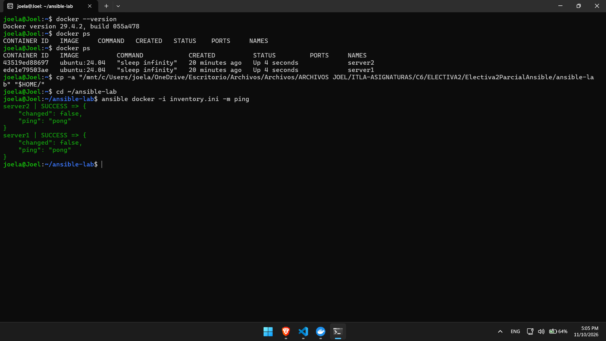
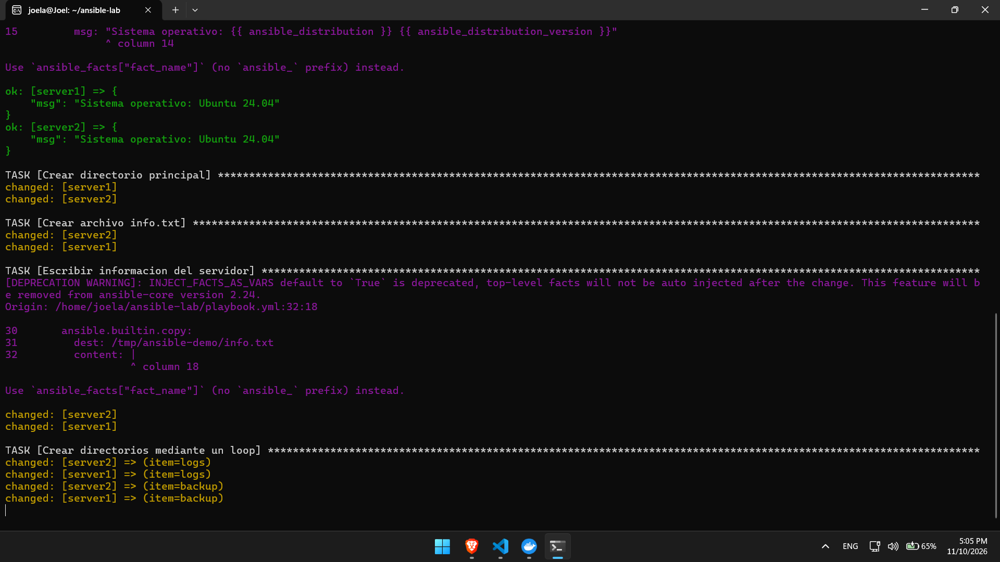
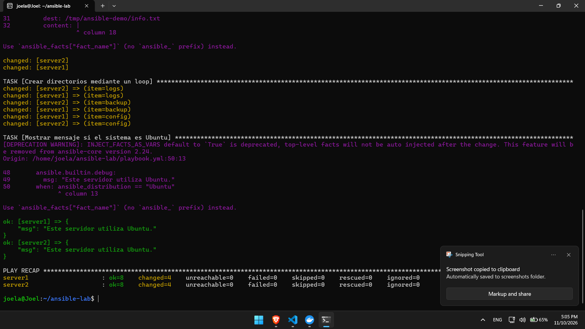
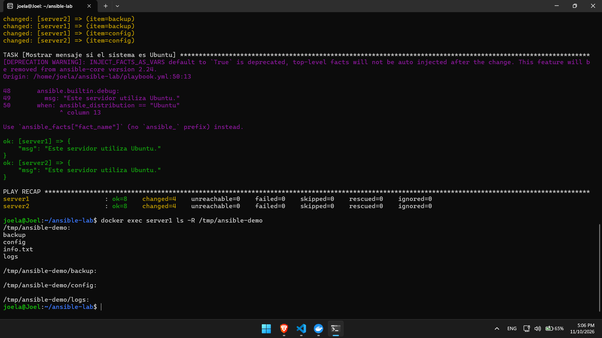
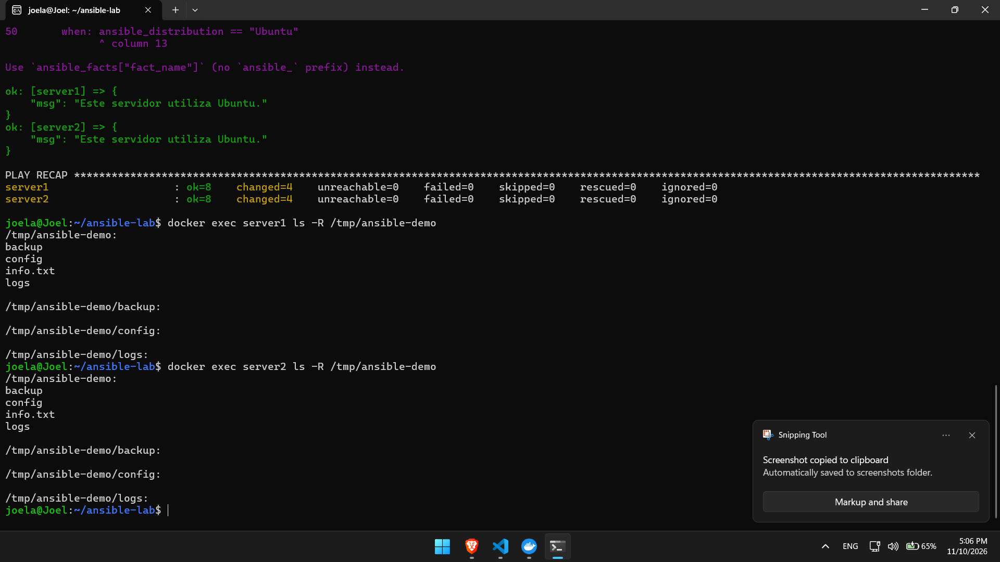
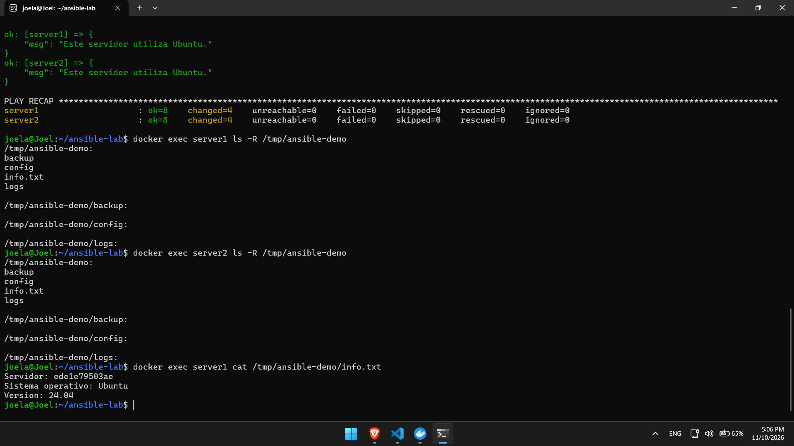
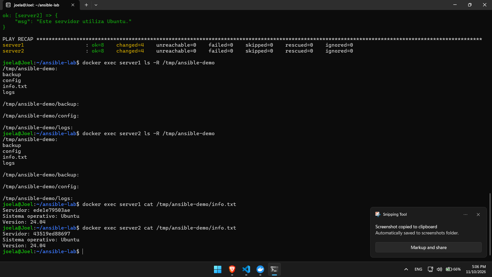

# Laboratorio Ansible con Docker

## Objetivo

Realizar una práctica de automatización utilizando Ansible y Docker, configurando dos servidores Ubuntu para ejecutar tareas de administración de forma remota.

## Estructura del proyecto

```text
ansible-lab/
├── docker-compose.yml
├── inventory.ini
├── playbook.yml
└── README.md
```

## Iniciar los contenedores

Para iniciar los servidores Docker:

```bash
docker compose up -d
```

Para comprobar que están ejecutándose:

```bash
docker ps
```

## Ejecutar el Playbook

Para ejecutar las tareas de automatización:

```bash
ansible-playbook -i inventory.ini playbook.yml
```

## Tareas realizadas

- Mostrar el nombre de cada servidor.
- Identificar el sistema operativo.
- Crear el directorio ansible-demo.
- Crear el archivo info.txt con información del servidor.
- Crear los directorios logs, backup y config mediante un loop.
- Mostrar un mensaje cuando el sistema operativo sea Ubuntu.

## Evidencia de ejecución

A continuación se muestra la captura de pantalla de la ejecución exitosa del Playbook en ambos servidores.

### Creacion de inventario.ini




----
### PlayBook





----

### Directorios 




----
### Lecturas del archivo txt 




-----

`Proposito: Este es un examen parcial de la asignatura de Electiva 2 (DevOps) del Instituto Tecnológico de las Américas ITLA.`